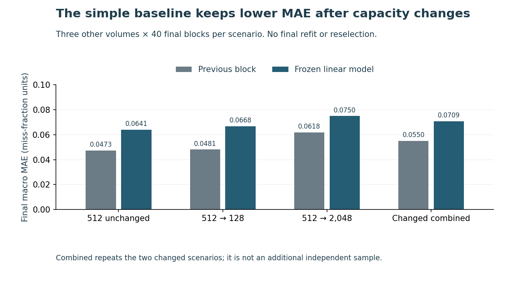

# Check the simple baseline before refitting a cache forecast

Changing cache capacity can change what a storage planner is trying to forecast. This trace exercise compares a selected linear model with a previous-block baseline after simulated cache shrink and expansion.

**Finding under the predeclared MAE objective:** the previous-block baseline has mean absolute error **0.05498**, versus **0.07088** for the frozen linear model across changed scenarios. It has lower MAE in all nine final volume/scenario groups, including unchanged controls. Development also favors the baseline, so cache changes alone do not explain the linear model's weakness.

**The loss metric matters:** combined changed-group mean squared error favors the linear model, **0.011782 versus 0.012023**. The MAE result is not an overall win on every measure.

Keep the baseline, configuration boundaries and decision-relevant loss in the evaluation before investing in a more complex forecast. Under MAE, this benchmark does not justify replacing the previous-block baseline with the tested configuration-blind linear model.

These targets are simulated miss fractions per 1,000 recorded requests. Slots are abstract object positions, not RAM bytes. Production latency, IOPS, throughput, energy, savings and deployment benefit are unmeasured.

Read the [six-page independent study](paper/manuscript.pdf), inspect [every final group and metric](results/final/summary.json), or run the [offline implementation exercise](IMPLEMENTATION_EXERCISE.md).

~~~sh
python -m pip install -r requirements.txt
python src/review_cli.py examples/authored-changed-context.json
python src/review_cli.py examples/unknown-history.json
python src/replay.py --output ../fresh-replay
~~~

The examples are authored. The CLI accepts three completed block miss counts, newest first, and declared configuration context. It changes no cache, sends no alert and makes no source request. Missing history stays UNKNOWN.

## Evidence and reproducibility

- Six source files selected by displayed size metadata before values. Complete private compressed captures total 126,293,595 bytes; fixed 200,000-request prefixes produce 1.2 million ordered ordinal IDs. An independent byte parser checks every ordinal and quality field in 1,200,060 conditions. The future-access field is never decoded or published.
- Equal-object LRU starts cold at 512 slots. Three development volumes supply 351 training and 120 validation origins. All three ridge penalties remain visible; selected λ=0.01 is a lower-grid boundary winner without a grid expansion or validation refit. Development MAE is 0.0731 for the baseline versus 0.081148 for the linear model.
- [Forty-seven dependencies](data/dependency_freeze.json) were committed before any final-volume cache simulation, features or scores. Source request IDs were already available; collection was not blinded. The other three volumes' final 40 blocks run under 512 unchanged, 128-slot shrink and 2,048-slot expansion, preserving resident state.
- Final results retain 720 predictions, 360 origins per model and 240 changed-scenario origins per model. Combined summaries repeat dependent observations, not an additional sample. Every group's MAE, MSE, signed error, clipping count, target mean and the first-five-block view remain visible.
- Independent dictionary/heap simulation, SQLite lag windows and NumPy regression check 603,643 development conditions including 600,000 request misses, and 1,806,171 final conditions including 1,800,000 request misses. Exact rational metrics and selection match; coefficients/predictions/metrics also pass declared numerical tolerances.
- Twenty-seven fixture methods and three authored examples; three inspected figures with 102 mapped source values, 276 actual SVG coordinates and nine hashes; 70 source-bound paper values, 321 paper conditions and all six current rendered pages.

Use a full-history clone and a fresh external output. Replay recomputes all simulations and forecasts, verifies frozen/source bytes, compares logical JSON rather than incidental gzip headers and leaves measured runtime receipts intact. New execution times remain separate. Exact isolated replay, Linux CI, tree and tag proof belong to the selected revision: see the [pull request](https://github.com/S3R3Bii/cache-change-forecast-audit/pull/2) and [Actions](https://github.com/S3R3Bii/cache-change-forecast-audit/actions).

## Scope and source

The [protocol](PROTOCOL.md), [source attribution and transformation](DATA_RIGHTS.md), [environment](ENVIRONMENT.md) and [review receipt](REVIEW_RECEIPT.json) provide the details. Source-derived sequences remain under CC BY 4.0, attributed to the cache collection curated/converted by Juncheng Yang and the original Narayanan, Donnelly and Rowstron FAST 2008 Microsoft Cambridge study. Prefix selection, ordinal remapping and simulation are modifications. MIT covers our code.

The collection README summarizes thirteen traces while the observed converted folder contains fourteen objects; the difference is retained, not silently reconciled. The small size-selected prefixes are not representative. Two final volumes share a server label, all scenarios share source sequences, and count-block horizons cover different source spans. Cold-start, equal-object LRU ignores source sizes, operation types, admission, prefetching, parallelism and actual storage layers.

The linear fit receives no capacity indicator; this deliberately tests configuration-blind transfer and does not recommend hiding a known change. Actual cache planning needs byte-aware, prospective production measurements and an explicit decision cost. No scientific novelty, causal generalization, adoption, deployment, energy or saving claim follows. The independent study is not peer reviewed. Raw traces, credentials and formal-publication projects, including Azure optimization, remain private.
